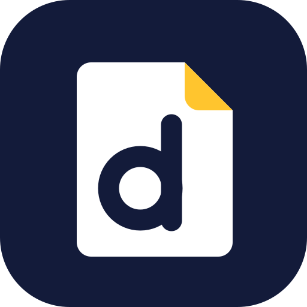

<p align="center">
  
</p>

<h1 align="center">PDFDika</h1>

<p align="center">
  Semua alat PDF, langsung di browser. Gratis, tanpa unggahan, dan tetap bisa dipakai offline.
</p>

<p align="center">
  <a href="https://andikapramudya-project.github.io/PDF-Dika/"><b>Buka PDFDika</b></a>
</p>

---

## Tentang

PDFDika adalah kumpulan alat PDF yang berjalan sepenuhnya di perangkat pengguna. Setiap file diproses di dalam browser dengan JavaScript dan WebAssembly, sehingga dokumen tidak pernah dikirim ke server mana pun.

Situs ini bisa dipasang sebagai aplikasi (PWA), tersedia dalam Bahasa Indonesia dan Inggris, mendukung mode gelap, dan nyaman dipakai di ponsel maupun desktop.

## Prinsip

- **Privat.** Tidak ada unggahan, akun, analitik, atau pelacakan. Semua pustaka disimpan di repositori ini, tanpa CDN pihak ketiga.
- **Offline.** Setelah kunjungan pertama, alat tetap berfungsi tanpa koneksi internet.
- **Ringan.** Situs statis tanpa proses build. Mesin besar seperti OCR hanya dimuat saat alatnya dipakai.

## Alat yang tersedia

| Kategori | Alat |
| --- | --- |
| **Atur** | Gabung PDF, Pisah PDF, Atur halaman, Putar, Hapus halaman, Ambil halaman, Balik urutan, Sisipkan halaman kosong, Beberapa halaman per lembar |
| **Edit** | Tanda tangan, Watermark, Nomor halaman, Tambah teks, Tambah gambar, Edit properti |
| **Konversi** | Mode baca & EPUB, PDF ke Word, Gambar ke PDF, PDF ke gambar, PDF ke teks, OCR (Indonesia dan Inggris) |
| **Optimalkan** | Kompres PDF |
| **Keamanan** | Kunci PDF (AES-256), Buka kunci PDF, Hapus metadata |

### Sorotan

- **Mode baca & EPUB.** Menyusun ulang PDF (buku, modul, jurnal dua kolom) menjadi teks yang mengalir agar nyaman dibaca di HP. Header, footer, dan nomor halaman dibuang, kata yang terpotong disambung kembali, dan judul bab menjadi daftar isi. Hasilnya bisa disimpan sebagai HTML offline, EPUB, Word (DOCX), atau PDF ukuran HP.
- **OCR.** Mengenali teks pada PDF hasil scan atau foto, lalu menghasilkan PDF yang bisa dicari dan disalin, atau file teks biasa. PDF scan juga bisa langsung dibuka di Mode baca.
- **Kompres.** Mengompres ulang gambar di dalam PDF dengan tiga tingkat kualitas, lalu merapikan struktur file tanpa mengurangi kualitas teks.

### Segera hadir

Sensor (redaksi), potong dan ubah ukuran halaman, hitam putih, ratakan formulir, header dan footer, ambil gambar, PDF ke PowerPoint, PDF ke Excel, bandingkan PDF, isi formulir, dan penanda (bookmark).

## Teknologi

| Bagian | Pustaka |
| --- | --- |
| Membuat dan mengubah PDF | [pdf-lib](https://pdf-lib.js.org/) |
| Pratinjau, teks, dan Mode baca | [PDF.js](https://mozilla.github.io/pdf.js/) |
| OCR | [Tesseract.js](https://tesseract.projectnaptha.com/) dengan data bahasa `ind` dan `eng` |
| Enkripsi, dekripsi, dan optimasi struktur | [qpdf](https://qpdf.sourceforge.io/) (WebAssembly) |
| Arsip ZIP, EPUB, dan DOCX | [JSZip](https://stuk.github.io/jszip/) |
| Huruf | [Plus Jakarta Sans](https://github.com/tokotype/PlusJakartaSans) |

Antarmuka ditulis dengan HTML, CSS, dan modul JavaScript murni, tanpa framework.

## Struktur proyek

```
├── index.html            Kerangka aplikasi
├── css/style.css         Gaya, token warna, tema gelap, dan animasi
├── js/
│   ├── app.js            Beranda, router, dan teks antarmuka (ID/EN)
│   ├── core.js           Utilitas bersama dan pemuat pustaka
│   ├── ui.js             Komponen: area unggah, daftar file, kisi halaman, panel
│   ├── tools.js          Daftar kategori dan alat
│   ├── tools/            Satu file per alat
│   └── reflow/           Mesin Mode baca, pembaca HTML, dan ekspor EPUB/DOCX/PDF
├── vendor/               Pustaka pihak ketiga (disimpan lokal)
├── fonts/  icons/        Huruf dan ikon aplikasi
├── manifest.webmanifest  Konfigurasi PWA
└── sw.js                 Service worker untuk mode offline
```

## Menjalankan secara lokal

Tidak ada dependensi yang perlu dipasang. Cukup jalankan server statis apa pun dari folder proyek:

```bash
python3 -m http.server 8000
```

Lalu buka <http://localhost:8000>.

## Deploy

Situs dipublikasikan dengan GitHub Pages dari cabang `main` (folder root). Setiap perubahan yang di-push ke `main` akan tayang otomatis.

Saat mengubah file, naikkan nilai `VERSION` di `sw.js` agar pengunjung mendapatkan versi terbaru. Jika menambah file baru, masukkan juga ke daftar `FILES`. Folder `vendor/tesseract` dan `vendor/qpdf` sengaja tidak dimasukkan karena ukurannya besar; keduanya disimpan ke cache saat pertama kali dipakai.

## Lisensi pihak ketiga

| Komponen | Lisensi |
| --- | --- |
| pdf-lib | MIT |
| PDF.js | Apache-2.0 |
| Tesseract.js dan tesseract.js-core | Apache-2.0 |
| Data bahasa Tesseract (tessdata) | Apache-2.0 |
| qpdf | Apache-2.0 |
| JSZip | MIT atau GPL-3.0 |
| Plus Jakarta Sans | SIL Open Font License 1.1 |

---

<p align="center">© PDFDika</p>
